# GeraiExpress v2 — Architecture & Flow Diagrams (Mermaid)

Rendered views of the accepted contracts. **The specs own the facts**; when a diagram and a spec disagree, the spec
wins and this file is corrected. Diagrams are validated with `mmdc` (mermaid 12) before commit; GitHub renders them.

| # | Diagram | Type | Source of truth |
|---|---|---|---|
| 1 | System context | flowchart (C4-style) | ARCHITECTURE §1, ADR-0002/0003 |
| 2 | Containers and stores | flowchart | ARCHITECTURE §2, ADR-0006, spec 07 §3 |
| 3 | Request routing by host | flowchart | ARCHITECTURE §3, spec 11 §3 |
| 4 | Control-plane data (D1) | ERD | spec 01 §0, §2.6–2.7, spec 11 §4 |
| 5 | Tenant data (`GeraiVaultDO`) | ERD | spec 01 §0–§2.5 |
| 6 | Counter checkout and dispatch | sequence | spec 03 §1, ADR-0004, spec 09 §3 |
| 7 | Webhook ingest and apply | sequence | spec 01 §2.7, §3 |
| 8 | Finance sync (`/invoices`) | sequence | spec 09 |
| 9 | Custom domain onboarding | sequence | spec 11 §5 |
| 10 | Shipment status (effective) | state | spec 01 §3 |
| 11 | Counter payment | state | spec 03 §1.1 |
| 12 | Sign-up and OTP email | sequence | spec 05 §2, spec 12 |
| 13 | Partner API via relay | sequence | spec 10, DEC-219 |
| 14 | Milestones | flowchart | ROADMAP, TASKS |

---

## 1. System context

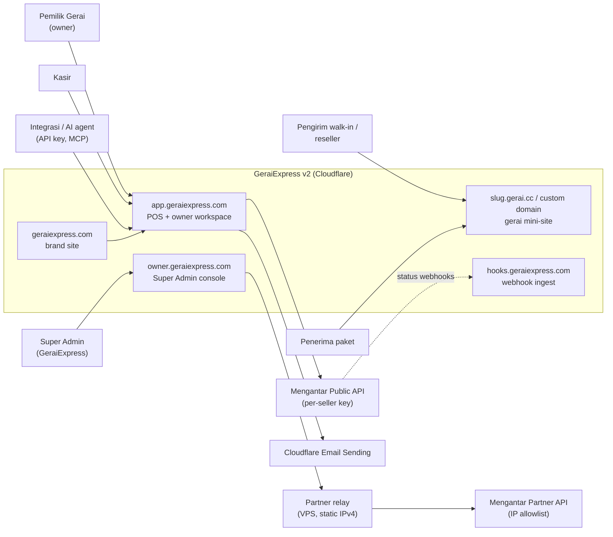

## 2. Containers and stores

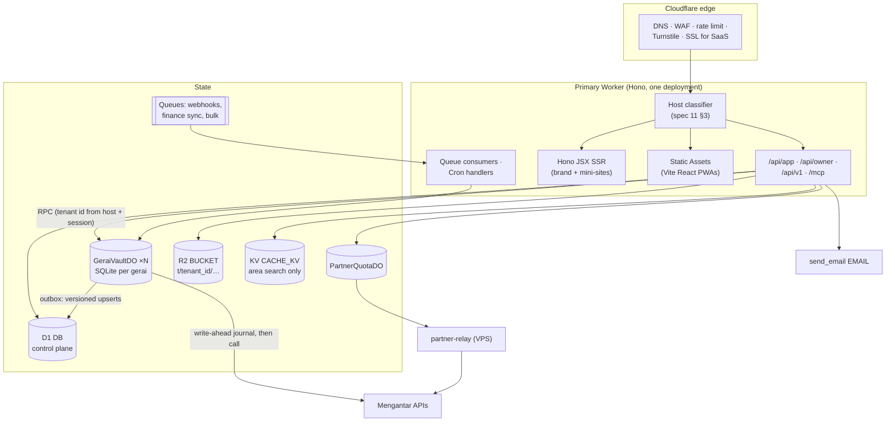

## 3. Request routing by host

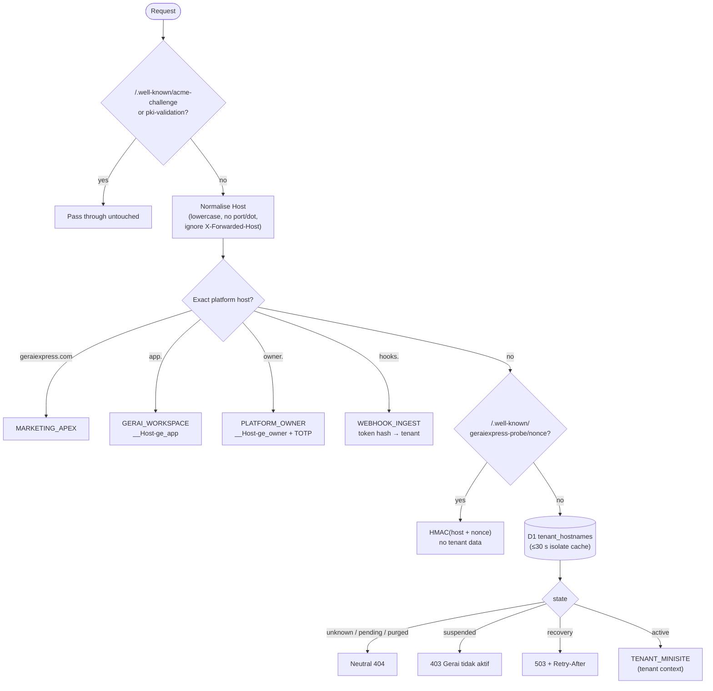

## 4. Control-plane data (D1)

```mermaid
erDiagram
    USERS {
        text id PK
        text email UK
        text password_hash
        int created_at
    }
    SESSIONS {
        text id PK
        text user_id FK
        text host_context
        int expires_at
    }
    EMAIL_OTPS {
        text id PK
        text email_hash
        text otp_hash
        int expires_at
        int failed_attempts
    }
    SUPER_ADMINS {
        text user_id PK
        text totp_secret_encrypted
    }
    TENANTS {
        text id PK
        text slug UK
        text status
        int routing_version
    }
    TENANT_MEMBERS {
        text tenant_id FK
        text user_id FK
        text role
    }
    TENANT_HOSTNAMES {
        text hostname PK
        text tenant_id FK
        text kind
        text state
        text cf_custom_hostname_id
    }
    TENANT_API_KEYS {
        text id PK
        text tenant_id FK
        text key_hash
        text scopes
    }
    TENANT_DISCOUNT_RULES {
        text id PK
        text tenant_id FK
        text courier_code
        int assigned_bps
    }
    WEBHOOK_ROUTES {
        text token_hash PK
        text tenant_id FK
        int key_version
        text state
    }
    SHIPMENT_INDEX {
        text tenant_id PK
        text slug PK
        text awb_number
        text status
        int version
    }
    RECIPIENT_RISK_INDEX {
        text phone_hmac PK
        text tenant_id PK
        int delivered_count
        int rts_count
        int version
    }
    TENANT_DAILY_STATS {
        text tenant_id PK
        text day PK
        int shipments
        int version
    }
    EMAIL_OUTBOX {
        text id PK
        text template_id
        text to_email_hash
        text payload_encrypted
        int expires_at
        text state
    }
    USERS ||--o{ SESSIONS : has
    USERS ||--o| SUPER_ADMINS : "may be"
    USERS ||--o{ TENANT_MEMBERS : joins
    TENANTS ||--o{ TENANT_MEMBERS : has
    TENANTS ||--o{ TENANT_HOSTNAMES : "served on"
    TENANTS ||--o{ TENANT_API_KEYS : issues
    TENANTS ||--o{ TENANT_DISCOUNT_RULES : "priced by"
    TENANTS ||--o{ WEBHOOK_ROUTES : "receives via"
    TENANTS ||--o{ SHIPMENT_INDEX : "indexed in"
    TENANTS ||--o{ RECIPIENT_RISK_INDEX : contributes
    TENANTS ||--o{ TENANT_DAILY_STATS : reports
```

## 5. Tenant data (`GeraiVaultDO`, one SQLite store per gerai)

The link from every tenant table to D1 `TENANTS` is application-enforced (separate databases, ADR-0006).

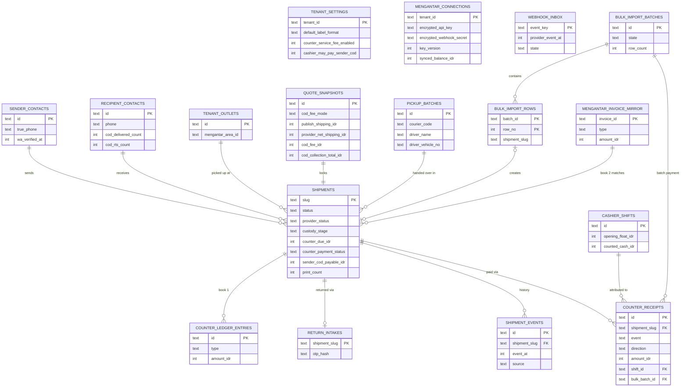

## 6. Counter checkout and dispatch

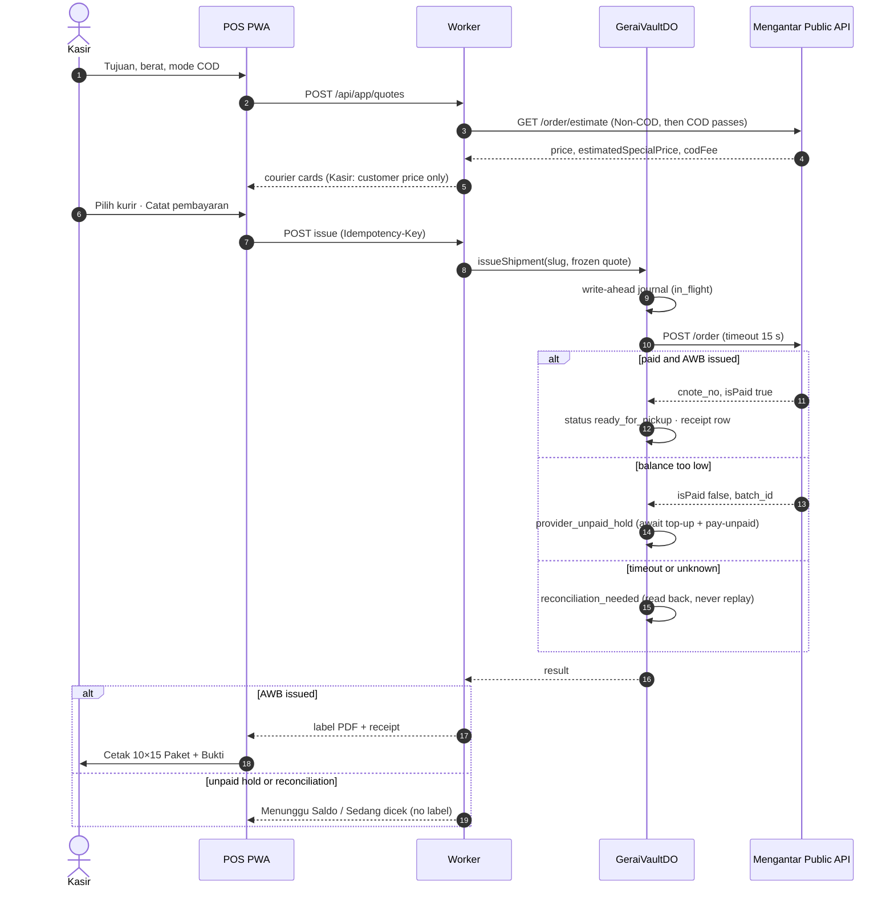

## 7. Webhook ingest and apply

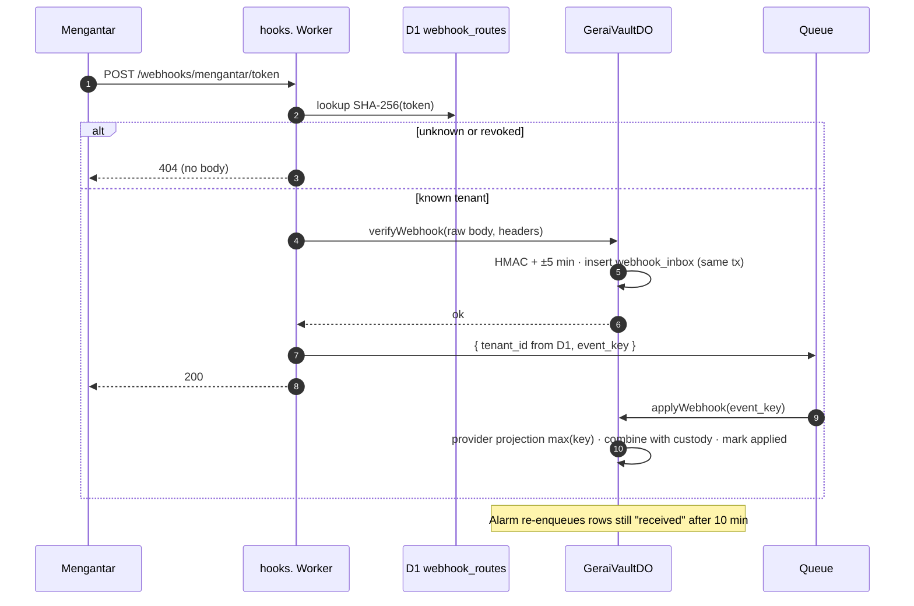

## 8. Finance sync (`/invoices`)

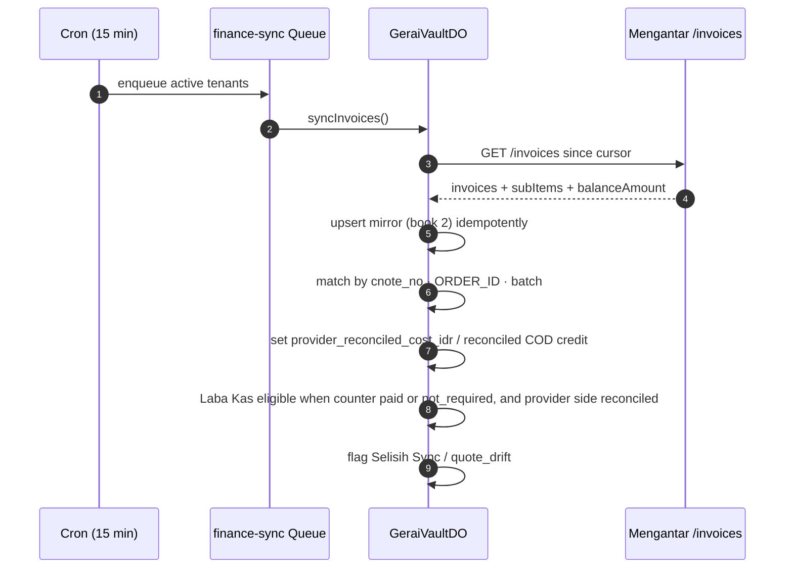

## 9. Custom domain onboarding

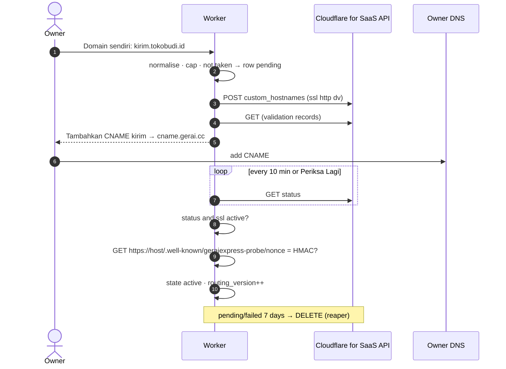

## 10. Shipment status (effective, after combine)

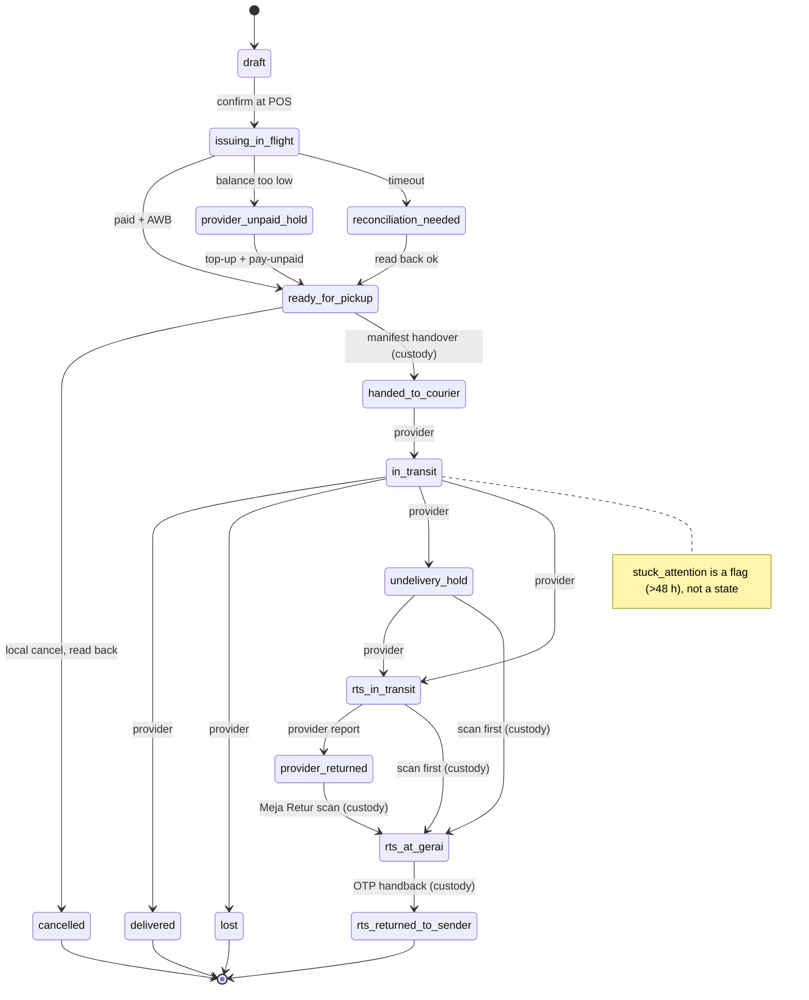

## 11. Counter payment

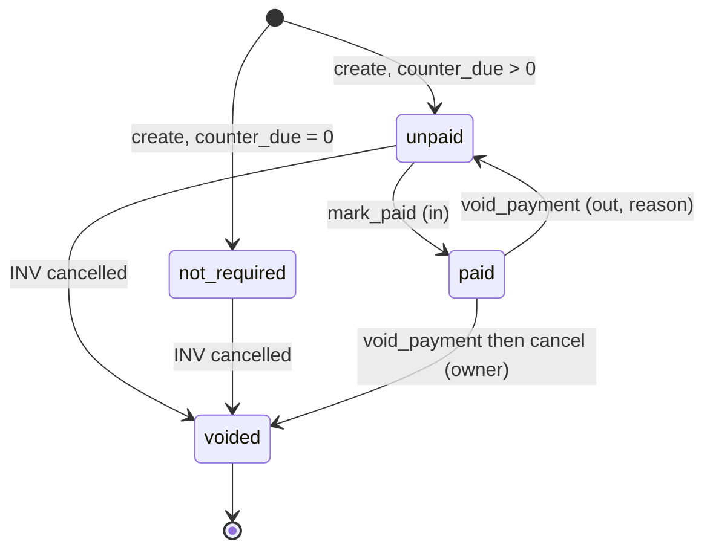

## 12. Sign-up and OTP email

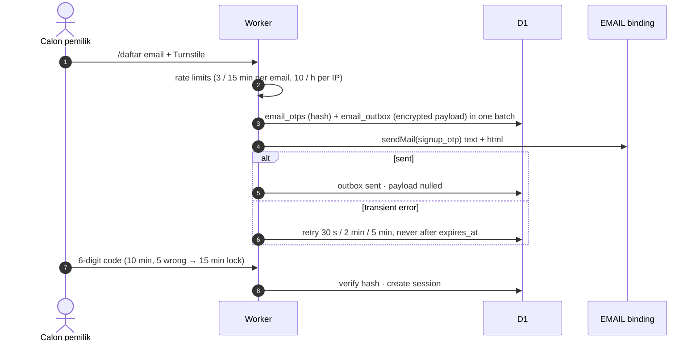

## 13. Partner API via relay

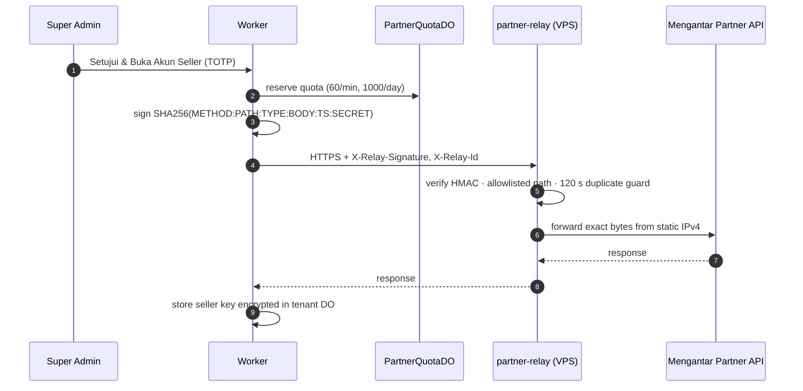

## 14. Milestones

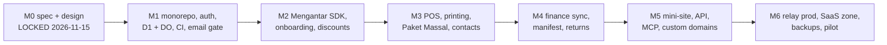
